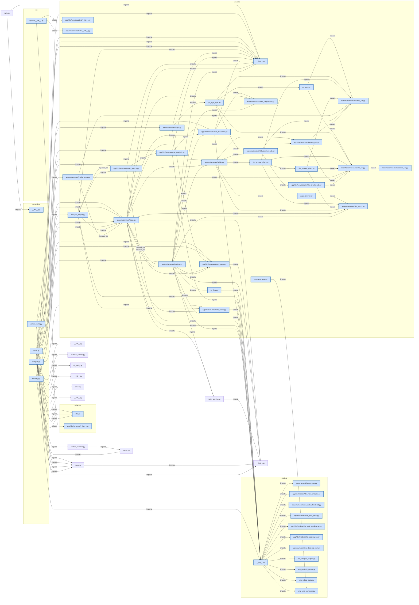

# backend — XHS Module

> **Focused guide for:** `app/xhs/` — XHS (Xiaohongshu) 笔记与评论采集、AI 分析、关键词追踪模块。

| | |
|---|---|
| **Languages** | dockerfile, javascript, json, python |
| **Frameworks** | FastAPI, SQLAlchemy, Uvicorn, Pydantic, APScheduler, Playwright, Docker |
| **Module scope** | 49 files under `app/xhs/` + 21 dependency files |
| **Subgraph** | 141 nodes, 307 edges |

## Architecture

The XHS module spans 4 architectural layers:

### API / Controllers Layer

FastAPI route controllers for the common, hotlist, analysis, xhs, stock, resource and skills domains, the app/main.py entry point that wires all routers and lifecycle, and core FastAPI dependencies (JWT auth / media-token deps) used by endpoints.

Key XHS components: [`app/xhs/controllers/__init__.py`](vscode://file//Users/lipeng01/vscode/workbench/backend/app/xhs/controllers/__init__.py), [`app/xhs/controllers/analysis.py`](vscode://file//Users/lipeng01/vscode/workbench/backend/app/xhs/controllers/analysis.py), [`app/xhs/controllers/collect_tasks.py`](vscode://file//Users/lipeng01/vscode/workbench/backend/app/xhs/controllers/collect_tasks.py), [`app/xhs/controllers/notes.py`](vscode://file//Users/lipeng01/vscode/workbench/backend/app/xhs/controllers/notes.py), [`app/xhs/controllers/tracking.py`](vscode://file//Users/lipeng01/vscode/workbench/backend/app/xhs/controllers/tracking.py)

### Service / Business Logic Layer

Core business logic and orchestration: per-module services (hotlist RSS/feed crawler adapters, digest and ranking, XHS Playwright page crawling and analysis, stock market/valuation clients, Quark resource integration, skills registry), shared common services (AI and embedding gateways, skill runtime, notification), and app/core framework services (config, security, scheduler, logging, placeholder).

Key XHS components: [`app/xhs/services/ai_filter.py`](vscode://file//Users/lipeng01/vscode/workbench/backend/app/xhs/services/ai_filter.py), [`app/xhs/services/__init__.py`](vscode://file//Users/lipeng01/vscode/workbench/backend/app/xhs/services/__init__.py), [`app/xhs/services/analysis_project.py`](vscode://file//Users/lipeng01/vscode/workbench/backend/app/xhs/services/analysis_project.py), [`app/xhs/services/client/page_crawler.py`](vscode://file//Users/lipeng01/vscode/workbench/backend/app/xhs/services/client/page_crawler.py), [`app/xhs/services/client/pc_apis.py`](vscode://file//Users/lipeng01/vscode/workbench/backend/app/xhs/services/client/pc_apis.py), [`app/xhs/services/client/pc_login_apis.py`](vscode://file//Users/lipeng01/vscode/workbench/backend/app/xhs/services/client/pc_login_apis.py), [`app/xhs/services/client/xhs_crawler_client.py`](vscode://file//Users/lipeng01/vscode/workbench/backend/app/xhs/services/client/xhs_crawler_client.py), [`app/xhs/services/client/xhs_request_client.py`](vscode://file//Users/lipeng01/vscode/workbench/backend/app/xhs/services/client/xhs_request_client.py), [`app/xhs/services/comment_store.py`](vscode://file//Users/lipeng01/vscode/workbench/backend/app/xhs/services/comment_store.py), [`app/xhs/services/login.py`](vscode://file//Users/lipeng01/vscode/workbench/backend/app/xhs/services/login.py), [`app/xhs/services/media_proxy.py`](vscode://file//Users/lipeng01/vscode/workbench/backend/app/xhs/services/media_proxy.py), [`app/xhs/services/note_analysis.py`](vscode://file//Users/lipeng01/vscode/workbench/backend/app/xhs/services/note_analysis.py), [`app/xhs/services/note_cache.py`](vscode://file//Users/lipeng01/vscode/workbench/backend/app/xhs/services/note_cache.py), [`app/xhs/services/note_preprocess.py`](vscode://file//Users/lipeng01/vscode/workbench/backend/app/xhs/services/note_preprocess.py), [`app/xhs/services/note_structurer.py`](vscode://file//Users/lipeng01/vscode/workbench/backend/app/xhs/services/note_structurer.py), [`app/xhs/services/report_service.py`](vscode://file//Users/lipeng01/vscode/workbench/backend/app/xhs/services/report_service.py), [`app/xhs/services/spider.py`](vscode://file//Users/lipeng01/vscode/workbench/backend/app/xhs/services/spider.py), [`app/xhs/services/tasks.py`](vscode://file//Users/lipeng01/vscode/workbench/backend/app/xhs/services/tasks.py), [`app/xhs/services/token_store.py`](vscode://file//Users/lipeng01/vscode/workbench/backend/app/xhs/services/token_store.py), [`app/xhs/services/tracking.py`](vscode://file//Users/lipeng01/vscode/workbench/backend/app/xhs/services/tracking.py), [`app/xhs/services/utils/common_util.py`](vscode://file//Users/lipeng01/vscode/workbench/backend/app/xhs/services/utils/common_util.py), [`app/xhs/services/utils/cookie_util.py`](vscode://file//Users/lipeng01/vscode/workbench/backend/app/xhs/services/utils/cookie_util.py), [`app/xhs/services/utils/data_util.py`](vscode://file//Users/lipeng01/vscode/workbench/backend/app/xhs/services/utils/data_util.py), [`app/xhs/services/utils/http_util.py`](vscode://file//Users/lipeng01/vscode/workbench/backend/app/xhs/services/utils/http_util.py), [`app/xhs/services/utils/xhs_creator_util.py`](vscode://file//Users/lipeng01/vscode/workbench/backend/app/xhs/services/utils/xhs_creator_util.py), [`app/xhs/services/utils/xhs_util.py`](vscode://file//Users/lipeng01/vscode/workbench/backend/app/xhs/services/utils/xhs_util.py), [`app/xhs/services/xhs_errors.py`](vscode://file//Users/lipeng01/vscode/workbench/backend/app/xhs/services/xhs_errors.py), [`app/xhs/__init__.py`](vscode://file//Users/lipeng01/vscode/workbench/backend/app/xhs/__init__.py), [`app/xhs/services/client/__init__.py`](vscode://file//Users/lipeng01/vscode/workbench/backend/app/xhs/services/client/__init__.py), [`app/xhs/services/utils/__init__.py`](vscode://file//Users/lipeng01/vscode/workbench/backend/app/xhs/services/utils/__init__.py)

### Data / Persistence Layer

SQLAlchemy ORM models across all modules, the core database.py engine/session bootstrap that defines the declarative Base, and the seed.py bootstrap script that initializes the database and default admin user.

Key XHS components: [`app/xhs/models/xhs_note.py`](vscode://file//Users/lipeng01/vscode/workbench/backend/app/xhs/models/xhs_note.py), [`app/xhs/models/xhs_note_analysis.py`](vscode://file//Users/lipeng01/vscode/workbench/backend/app/xhs/models/xhs_note_analysis.py), [`app/xhs/models/xhs_note_structured.py`](vscode://file//Users/lipeng01/vscode/workbench/backend/app/xhs/models/xhs_note_structured.py), [`app/xhs/models/xhs_task_extra.py`](vscode://file//Users/lipeng01/vscode/workbench/backend/app/xhs/models/xhs_task_extra.py), [`app/xhs/models/xhs_task_pending_op.py`](vscode://file//Users/lipeng01/vscode/workbench/backend/app/xhs/models/xhs_task_pending_op.py), [`app/xhs/models/xhs_tracking_hit.py`](vscode://file//Users/lipeng01/vscode/workbench/backend/app/xhs/models/xhs_tracking_hit.py), [`app/xhs/models/xhs_tracking_task.py`](vscode://file//Users/lipeng01/vscode/workbench/backend/app/xhs/models/xhs_tracking_task.py), [`app/xhs/models/__init__.py`](vscode://file//Users/lipeng01/vscode/workbench/backend/app/xhs/models/__init__.py), [`app/xhs/models/xhs_analysis_project.py`](vscode://file//Users/lipeng01/vscode/workbench/backend/app/xhs/models/xhs_analysis_project.py), [`app/xhs/models/xhs_analysis_report.py`](vscode://file//Users/lipeng01/vscode/workbench/backend/app/xhs/models/xhs_analysis_report.py), [`app/xhs/models/xhs_collect_stats.py`](vscode://file//Users/lipeng01/vscode/workbench/backend/app/xhs/models/xhs_collect_stats.py), [`app/xhs/models/xhs_note_comment.py`](vscode://file//Users/lipeng01/vscode/workbench/backend/app/xhs/models/xhs_note_comment.py)

### Data Types / Schemas Layer

Pydantic request/response schemas and DTOs for the common, hotlist, analysis, xhs, stock, resource and skills domains that define API payload contracts.

Key XHS components: [`app/xhs/schemas/xhs.py`](vscode://file//Users/lipeng01/vscode/workbench/backend/app/xhs/schemas/xhs.py), [`app/xhs/schemas/__init__.py`](vscode://file//Users/lipeng01/vscode/workbench/backend/app/xhs/schemas/__init__.py)

## Architecture Overview

The XHS module is organized into **5 part(s)**. The diagram below shows the module's structure and how its files depend on one another.

### Parts & Modules

- **xhs** (1)
  - [`app/xhs/__init__.py`](vscode://file//Users/lipeng01/vscode/workbench/backend/app/xhs/__init__.py) — Package marker for the XHS (Xiaohongshu) domain: post and comment collection; empty __init__.py.
- **controllers** (5)
  - [`app/xhs/controllers/__init__.py`](vscode://file//Users/lipeng01/vscode/workbench/backend/app/xhs/controllers/__init__.py) — Empty package initializer that marks the XHS controllers directory as a Python package.
  - [`app/xhs/controllers/analysis.py`](vscode://file//Users/lipeng01/vscode/workbench/backend/app/xhs/controllers/analysis.py) — FastAPI router for XHS analysis: project CRUD, note management, skill-backed and template-based note analyses streamed over SSE, and report save, combine, list, and append endpoints.
  - [`app/xhs/controllers/collect_tasks.py`](vscode://file//Users/lipeng01/vscode/workbench/backend/app/xhs/controllers/collect_tasks.py) — FastAPI router (prefix /api/xhs) for XHS account token management, QR/phone login flows, collection task CRUD with incremental collection and comment backfill, result downloads (excel/comments/zip), and a media proxy endpoint.
  - [`app/xhs/controllers/notes.py`](vscode://file//Users/lipeng01/vscode/workbench/backend/app/xhs/controllers/notes.py) — FastAPI router for note management: paginated note-task listing, per-note comments, AI-structured data views, manual note refresh via global cache, and a background Zhipu AI-processing backfill for missing/failed structured notes.
  - [`app/xhs/controllers/tracking.py`](vscode://file//Users/lipeng01/vscode/workbench/backend/app/xhs/controllers/tracking.py) — FastAPI router for keyword tracking tasks: CRUD of tracking tasks, immediate scan trigger, hit listing/deletion, and an AI filter dry-run against the latest matched notes without persisting.
- **models** (12)
  - [`app/xhs/models/__init__.py`](vscode://file//Users/lipeng01/vscode/workbench/backend/app/xhs/models/__init__.py) — Barrel module re-exporting all XHS SQLAlchemy model classes (XhsAnalysisProject, XhsAnalysisReport, XhsCollectStats, XhsNote, XhsNoteComment, tracking/task models) so services import models from a single package.
  - [`app/xhs/models/xhs_analysis_project.py`](vscode://file//Users/lipeng01/vscode/workbench/backend/app/xhs/models/xhs_analysis_project.py) — SQLAlchemy models for AI analysis projects: XhsAnalysisProject (user-defined analysis topic) and XhsAnalysisProjectNote (many-to-many association storing only note references, not content).
  - [`app/xhs/models/xhs_analysis_report.py`](vscode://file//Users/lipeng01/vscode/workbench/backend/app/xhs/models/xhs_analysis_report.py) — SQLAlchemy model XhsAnalysisReport: immutable snapshot of a saved AI analysis, storing question, result, template, model and the source notes as JSON so later project edits never alter a saved report.
  - [`app/xhs/models/xhs_collect_stats.py`](vscode://file//Users/lipeng01/vscode/workbench/backend/app/xhs/models/xhs_collect_stats.py) — SQLAlchemy model XhsCollectStats: per-task counters for collection filtering/processing (candidates, fetch failures, low-content drops, collected notes, structured ok/failed) used to audit collection quality.
  - [`app/xhs/models/xhs_note_analysis.py`](vscode://file//Users/lipeng01/vscode/workbench/backend/app/xhs/models/xhs_note_analysis.py) — SQLAlchemy ORM model XhsNoteAnalysis: records one AI analysis (question, result, model, feedback) per analysis project for the currently selected note; the note content itself is read live from XhsTaskExtra.
  - [`app/xhs/models/xhs_note_comment.py`](vscode://file//Users/lipeng01/vscode/workbench/backend/app/xhs/models/xhs_note_comment.py) — SQLAlchemy model XhsNoteComment: write-through comment table keyed by XHS comment_id with note_id, content, like count, author info and parent comment id; supports crash-safe incremental comment persistence.
  - [`app/xhs/models/xhs_note_structured.py`](vscode://file//Users/lipeng01/vscode/workbench/backend/app/xhs/models/xhs_note_structured.py) — SQLAlchemy ORM model XhsNoteStructured: per-note LLM pre-processing result (category, city, summary, key points) keyed by note_id with a content_hash for idempotency, so unchanged notes skip re-invoking the LLM.
  - [`app/xhs/models/xhs_note.py`](vscode://file//Users/lipeng01/vscode/workbench/backend/app/xhs/models/xhs_note.py) — SQLAlchemy ORM model XhsNote: global XHS note cache keyed by note_id storing fetched note detail (title, engagement counts, images, tags as JSON-in-Text) reused across collect and tracking tasks, with last_fetched_at as the TTL anchor for refetch.
  - [`app/xhs/models/xhs_task_extra.py`](vscode://file//Users/lipeng01/vscode/workbench/backend/app/xhs/models/xhs_task_extra.py) — SQLAlchemy ORM model XhsTaskExtra: 1:1 extension of the generic Task table storing XHS collect progress (phase, current/total) and preview note/comment JSON without modifying the shared Task schema.
  - [`app/xhs/models/xhs_task_pending_op.py`](vscode://file//Users/lipeng01/vscode/workbench/backend/app/xhs/models/xhs_task_pending_op.py) — SQLAlchemy ORM model XhsTaskPendingOp: records the pending/running operation type (collect vs incremental) per task so requeue_pending_tasks restarts incremental work with the correct handler after a process restart.
  - [`app/xhs/models/xhs_tracking_hit.py`](vscode://file//Users/lipeng01/vscode/workbench/backend/app/xhs/models/xhs_tracking_hit.py) — SQLAlchemy ORM model XhsTrackingHit: deduplication record per (tracking_task_id, note_id) with a matched flag, stored note JSON, and AI filter results (structured data, is_match, confidence, raw response).
  - [`app/xhs/models/xhs_tracking_task.py`](vscode://file//Users/lipeng01/vscode/workbench/backend/app/xhs/models/xhs_tracking_task.py) — SQLAlchemy ORM model XhsTrackingTask: periodic XHS keyword tracking task with search filters, interval minutes, robot notification configuration (channels, time window, frequency) and optional AI filter settings.
- **schemas** (2)
  - [`app/xhs/schemas/__init__.py`](vscode://file//Users/lipeng01/vscode/workbench/backend/app/xhs/schemas/__init__.py) — Package marker for XHS schemas; empty __init__.py marking the XHS data-model directory.
  - [`app/xhs/schemas/xhs.py`](vscode://file//Users/lipeng01/vscode/workbench/backend/app/xhs/schemas/xhs.py) — Pydantic request/response schemas for the XHS module: token status, phone/QR login inputs, collect and incremental task payloads, note analysis requests, report saving, and the tracking task configuration model with AI filter and notification fields.
- **services** (29)
  - [`app/xhs/services/__init__.py`](vscode://file//Users/lipeng01/vscode/workbench/backend/app/xhs/services/__init__.py) — Empty package initializer marking app.xhs.services as an importable package for the XHS service layer (spider, tasks, tracking, login, note cache/structurer, reports).
  - [`app/xhs/services/ai_filter.py`](vscode://file//Users/lipeng01/vscode/workbench/backend/app/xhs/services/ai_filter.py) — AI-based filter for XHS (Little Red Book) posts: renders prompts from note context, calls GLM structured generation, and parses the filtering verdicts.
  - [`app/xhs/services/analysis_project.py`](vscode://file//Users/lipeng01/vscode/workbench/backend/app/xhs/services/analysis_project.py) — Service layer for AI analysis projects: project CRUD with cascade cleanup, and note listing that resolves project notes from the global note cache, falling back to task previews and backfilling the cache.
  - [`app/xhs/services/client/__init__.py`](vscode://file//Users/lipeng01/vscode/workbench/backend/app/xhs/services/client/__init__.py) — Package marker for the XHS client services (API client and Playwright page crawler); empty __init__.py.
  - [`app/xhs/services/client/page_crawler.py`](vscode://file//Users/lipeng01/vscode/workbench/backend/app/xhs/services/client/page_crawler.py) — Playwright-based page-level XHS comment crawler: process-wide lazy headless Chromium, anti-automation fingerprinting, cookie injection, auth/not-found detection, DOM comment extraction with sub-comments, and streaming on_batch callbacks with jittered scrolling.
  - [`app/xhs/services/client/pc_apis.py`](vscode://file//Users/lipeng01/vscode/workbench/backend/app/xhs/services/client/pc_apis.py) — Legacy XHS web API client (XHS_Apis) with homefeed/user/search/comment/interaction endpoints; crawl-chain methods (search/detail/comments) now delegate to XhsCrawlerClient to avoid logic drift, keeping non-crawl methods as-is.
  - [`app/xhs/services/client/pc_login_apis.py`](vscode://file//Users/lipeng01/vscode/workbench/backend/app/xhs/services/client/pc_login_apis.py) — XHS login API client (XHSLoginApi): generates initial cookies with risk-control fingerprints (a1, web_id, sec_poison_id, websectiga, gid), drives QR-code and phone-code login, and captures the web_session cookie.
  - [`app/xhs/services/client/xhs_crawler_client.py`](vscode://file//Users/lipeng01/vscode/workbench/backend/app/xhs/services/client/xhs_crawler_client.py) — XHS crawl-chain client (XhsCrawlerClient) covering search, note detail, user notes, comments (deprecated), and watermark-free media URLs; signature-compatible with the legacy client but backed by the unified XhsRequestClient request layer with classified exceptions.
  - [`app/xhs/services/client/xhs_request_client.py`](vscode://file//Users/lipeng01/vscode/workbench/backend/app/xhs/services/client/xhs_request_client.py) — Unified XHS request client: request signing, cookie injection, proxy support, and classified retry policy (network backoff, rate-limit backoff on code 300013, auth/not-found errors raised without retry), returning a consistent (success, msg, res_json) tuple.
  - [`app/xhs/services/comment_store.py`](vscode://file//Users/lipeng01/vscode/workbench/backend/app/xhs/services/comment_store.py) — Comment write-through store: batch upsert of crawled comments into xhs_note_comments keyed by comment_id, cascade delete when notes are removed, and paginated per-note listing with legacy XhsTaskExtra JSON fallback.
  - [`app/xhs/services/login.py`](vscode://file//Users/lipeng01/vscode/workbench/backend/app/xhs/services/login.py) — XHS account login orchestration: wraps the terminal-oriented XHSLoginApi into web-polling QR-code and phone-verification flows, tracks pending sessions with TTL cleanup, and persists the resulting cookies via token_store.
  - [`app/xhs/services/media_proxy.py`](vscode://file//Users/lipeng01/vscode/workbench/backend/app/xhs/services/media_proxy.py) — Server-side anti-hotlink proxy for XHS CDN images/videos: allows only xhscdn.com hosts (SSRF guard), forwards requests with browser-like sec-fetch headers, and prefers locally downloaded media files because CDN signed URLs expire after about a day.
  - [`app/xhs/services/note_analysis.py`](vscode://file//Users/lipeng01/vscode/workbench/backend/app/xhs/services/note_analysis.py) — Builds AI-analysis context and prompts from selected XHS notes: formats raw or GLM-structured entries, estimates token usage with a 150k protective cap, replays prior Q&A rounds for multi-turn conversations, and persists analysis records to XhsNoteAnalysis.
  - [`app/xhs/services/note_cache.py`](vscode://file//Users/lipeng01/vscode/workbench/backend/app/xhs/services/note_cache.py) — Global dedup cache for XHS note details backed by the XhsNote table with a 3-day TTL; get_or_fetch_note reuses fresh cached data instead of re-crawling and falls back to stale cache when a refresh fails.
  - [`app/xhs/services/note_preprocess.py`](vscode://file//Users/lipeng01/vscode/workbench/backend/app/xhs/services/note_preprocess.py) — Rule-based note preprocessing: cleans text (strips emoji, hashtags, mentions, noise patterns) and detects low-content request-style posts (seek-help/recommend keywords), filtering them out before expensive media download and LLM structuring.
  - [`app/xhs/services/note_structurer.py`](vscode://file//Users/lipeng01/vscode/workbench/backend/app/xhs/services/note_structurer.py) — Structures XHS notes into compact JSON (category/summary/key_points/tags) via Zhipu GLM-4-Flash with content-hash idempotency, prompt-embedded schema validation, and ThreadPoolExecutor concurrency; results are persisted in XhsNoteStructured.
  - [`app/xhs/services/report_service.py`](vscode://file//Users/lipeng01/vscode/workbench/backend/app/xhs/services/report_service.py) — Persists successful AI analysis Q&A as durable reports in XhsAnalysisReport, snapshotting the notes used as evidence so reports survive project note changes; supports single, combined, and append report creation plus listing, retrieval and deletion.
  - [`app/xhs/services/spider.py`](vscode://file//Users/lipeng01/vscode/workbench/backend/app/xhs/services/spider.py) — Data_Spider crawler facade: fetches note details through XhsCrawlerClient, page-level comments through the Playwright-based XhsPageCrawler, flattens comment trees with parent ids, downloads media, and exports Excel for note/user/search collection flows.
  - [`app/xhs/services/tasks.py`](vscode://file//Users/lipeng01/vscode/workbench/backend/app/xhs/services/tasks.py) — Keyword collection task engine: a single-threaded queue worker serializes collect/incremental/tracking scans, with progress tracking, global note caching, low-content filtering, GLM structuring, media download, comment fetching with rate-limit circuit breaker, Excel export, and notification.
  - [`app/xhs/services/token_store.py`](vscode://file//Users/lipeng01/vscode/workbench/backend/app/xhs/services/token_store.py) — Persists the XHS login cookie as a fixed 'xhs_cookie' row in the ApiConfig table and validates login state via the /api/sns/web/v1/user/selfinfo heartbeat with a 60-second result cache.
  - [`app/xhs/services/tracking.py`](vscode://file//Users/lipeng01/vscode/workbench/backend/app/xhs/services/tracking.py) — Periodic XHS tracking tasks: APScheduler interval jobs enqueue scans through the shared serial worker, dedup against stored hits, filter by must-include/exclude keywords, optionally AI-structure and filter hits with GLM, notify configured channels, and record every execution as a Task.
  - [`app/xhs/services/utils/__init__.py`](vscode://file//Users/lipeng01/vscode/workbench/backend/app/xhs/services/utils/__init__.py) — Package marker for the XHS service utility helpers; empty __init__.py.
  - [`app/xhs/services/utils/common_util.py`](vscode://file//Users/lipeng01/vscode/workbench/backend/app/xhs/services/utils/common_util.py) — Shared XHS bootstrap utilities: env loading and init paths, a1/web_id generation, and fetching sec cookies/gid from Xiaohongshu anti-bot scripting endpoints using xsc-signed requests and execjs execution.
  - [`app/xhs/services/utils/cookie_util.py`](vscode://file//Users/lipeng01/vscode/workbench/backend/app/xhs/services/utils/cookie_util.py) — Tiny helper converting a '; ' or ';'-separated cookie string into a dict keyed by cookie name.
  - [`app/xhs/services/utils/data_util.py`](vscode://file//Users/lipeng01/vscode/workbench/backend/app/xhs/services/utils/data_util.py) — Normalizes raw XHS API payloads (user/note/comment) into flat dicts, downloads note media with a shared connection pool and ThreadPoolExecutor concurrency, writes detail files, and exports note/user/comment data to xlsx.
  - [`app/xhs/services/utils/http_util.py`](vscode://file//Users/lipeng01/vscode/workbench/backend/app/xhs/services/utils/http_util.py) — Defines the single REQUEST_TIMEOUT constant (15s) shared by all XHS HTTP calls.
  - [`app/xhs/services/utils/xhs_creator_util.py`](vscode://file//Users/lipeng01/vscode/workbench/backend/app/xhs/services/utils/xhs_creator_util.py) — Generates creator-center request signatures (x-s/x-t/x-s-common) by executing the bundled static JS via execjs, plus xsc header sets used by anti-bot scripting endpoints.
  - [`app/xhs/services/utils/xhs_util.py`](vscode://file//Users/lipeng01/vscode/workbench/backend/app/xhs/services/utils/xhs_util.py) — Core XHS request signing: compiles static JS signature scripts (with startup missing-file detection), generates xs/x-s-common/xray trace ids, browser-like common headers, and full request headers/params for the web API.
  - [`app/xhs/services/xhs_errors.py`](vscode://file//Users/lipeng01/vscode/workbench/backend/app/xhs/services/xhs_errors.py) — XHS crawling exception hierarchy (rate-limit, auth, not-found, network) modeled after MediaCrawler, letting the unified request layer and task layers decide between retry, backoff, or abort.

**External dependencies:**
- [`app/common/models/__init__.py`](vscode://file//Users/lipeng01/vscode/workbench/backend/app/common/models/__init__.py)
- [`app/common/services/notify_service.py`](vscode://file//Users/lipeng01/vscode/workbench/backend/app/common/services/notify_service.py)
- [`app/core/deps.py`](vscode://file//Users/lipeng01/vscode/workbench/backend/app/core/deps.py)
- [`app/main.py`](vscode://file//Users/lipeng01/vscode/workbench/backend/app/main.py)
- [`app/analysis/services/__init__.py`](vscode://file//Users/lipeng01/vscode/workbench/backend/app/analysis/services/__init__.py)
- [`app/analysis/services/analysis_service.py`](vscode://file//Users/lipeng01/vscode/workbench/backend/app/analysis/services/analysis_service.py)
- [`app/common/services/ai_config.py`](vscode://file//Users/lipeng01/vscode/workbench/backend/app/common/services/ai_config.py)
- [`app/common/services/ai_gateway/__init__.py`](vscode://file//Users/lipeng01/vscode/workbench/backend/app/common/services/ai_gateway/__init__.py)
- [`app/common/services/ai_gateway/base.py`](vscode://file//Users/lipeng01/vscode/workbench/backend/app/common/services/ai_gateway/base.py)
- [`app/common/services/skill_runtime/__init__.py`](vscode://file//Users/lipeng01/vscode/workbench/backend/app/common/services/skill_runtime/__init__.py)
- [`app/common/services/skill_runtime/context_resolver.py`](vscode://file//Users/lipeng01/vscode/workbench/backend/app/common/services/skill_runtime/context_resolver.py)
- [`app/common/services/skill_runtime/loader.py`](vscode://file//Users/lipeng01/vscode/workbench/backend/app/common/services/skill_runtime/loader.py)

### Module Relationships

- create_collect_task --[calls]--> app/xhs/services/tasks.py
- incremental_collect_task --[calls]--> app/xhs/services/tasks.py
- fetch_missing_comments_task --[calls]--> app/xhs/services/tasks.py
- download_collect_task --[calls]--> app/xhs/services/tasks.py
- proxy_media --[calls]--> app/xhs/services/media_proxy.py
- _run_structured_backfill --[calls]--> app/xhs/services/note_structurer.py
- process_existing_task_notes --[calls]--> app/xhs/services/note_structurer.py
- get_note_comments --[calls]--> comment_store.py
- refresh_note --[calls]--> app/xhs/services/note_cache.py
- refresh_note --[calls]--> app/xhs/services/spider.py
- ai_try_run_tracking_task --[calls]--> ai_filter.py
- run_tracking_task_now --[calls]--> app/xhs/services/tasks.py
- list_project_notes --[calls]--> app/xhs/services/note_cache.py
- delete_project --[calls]--> app/xhs/services/report_service.py
- _worker_loop --[calls]--> app/xhs/services/tracking.py
- _run_task --[calls]--> app/xhs/services/note_preprocess.py
- _fetch_notes_from_candidates --[calls]--> app/xhs/services/note_preprocess.py
- run_scan --[calls]--> ai_filter.py
- run_scan --[calls]--> app/xhs/services/note_preprocess.py
- poll_qrcode_login --[calls]--> app/xhs/services/token_store.py
- verify_phone_login --[calls]--> app/xhs/services/token_store.py
- start_qrcode_login --[calls]--> pc_login_apis.py
- format_notes_for_context --[calls]--> app/xhs/services/note_structurer.py
- save_report --[calls]--> app/xhs/services/note_analysis.py
- save_report --[calls]--> analysis_project.py
- save_combined_report --[calls]--> app/xhs/services/note_analysis.py
- save_combined_report --[calls]--> analysis_project.py
- Data_Spider --[calls]--> xhs_crawler_client.py
- Data_Spider --[calls]--> page_crawler.py
- analysis_project.py --[depends_on]--> app/xhs/services/report_service.py
- app/xhs/services/media_proxy.py --[depends_on]--> app/xhs/services/tasks.py
- app/xhs/services/tracking.py --[depends_on]--> app/xhs/services/tasks.py
- app/xhs/services/tasks.py --[depends_on]--> app/xhs/services/tracking.py
- requirements.txt --[documents]--> app/xhs/__init__.py
- main.py --[imports]--> __init__.py
- main.py --[imports]--> __init__.py
- analysis.py --[imports]--> __init__.py
- analysis.py --[imports]--> analysis_service.py
- analysis.py --[imports]--> ai_config.py
- analysis.py --[imports]--> __init__.py
- analysis.py --[imports]--> base.py
- analysis.py --[imports]--> __init__.py
- analysis.py --[imports]--> context_resolver.py
- analysis.py --[imports]--> loader.py
- analysis.py --[imports]--> database.py
- analysis.py --[imports]--> deps.py
- analysis.py --[imports]--> __init__.py
- analysis.py --[imports]--> registry_service.py
- analysis.py --[imports]--> xhs.py
- analysis.py --[imports]--> __init__.py
- analysis.py --[imports]--> analysis_project.py
- analysis.py --[imports]--> app/xhs/services/note_analysis.py
- analysis.py --[imports]--> app/xhs/services/report_service.py
- analysis.py --[imports]--> app/xhs/services/tasks.py
- app/xhs/models/xhs_note.py --[imports]--> database.py
- app/xhs/models/xhs_note_analysis.py --[imports]--> database.py
- app/xhs/models/xhs_note_structured.py --[imports]--> database.py
- app/xhs/models/xhs_task_extra.py --[imports]--> database.py
- app/xhs/models/xhs_task_pending_op.py --[imports]--> database.py
- app/xhs/models/xhs_tracking_hit.py --[imports]--> database.py
- app/xhs/models/xhs_tracking_task.py --[imports]--> database.py
- ai_filter.py --[imports]--> app/common/services/ai_gateway/glm_structured.py
- ai_filter.py --[imports]--> app/common/services/zhipu_config.py
- ai_filter.py --[imports]--> __init__.py
- collect_tasks.py --[imports]--> database.py
- collect_tasks.py --[imports]--> deps.py
- collect_tasks.py --[imports]--> xhs.py
- collect_tasks.py --[imports]--> __init__.py
- collect_tasks.py --[imports]--> app/xhs/services/login.py
- collect_tasks.py --[imports]--> app/xhs/services/media_proxy.py
- collect_tasks.py --[imports]--> app/xhs/services/tasks.py
- collect_tasks.py --[imports]--> app/xhs/services/token_store.py
- notes.py --[imports]--> __init__.py
- notes.py --[imports]--> app/common/services/zhipu_config.py
- notes.py --[imports]--> database.py
- notes.py --[imports]--> deps.py
- notes.py --[imports]--> __init__.py
- notes.py --[imports]--> __init__.py
- notes.py --[imports]--> app/xhs/services/note_cache.py
- notes.py --[imports]--> app/xhs/services/note_structurer.py
- notes.py --[imports]--> app/xhs/services/spider.py
- notes.py --[imports]--> app/xhs/services/tasks.py
- notes.py --[imports]--> app/xhs/services/token_store.py
- tracking.py --[imports]--> database.py
- tracking.py --[imports]--> deps.py
- tracking.py --[imports]--> xhs.py
- tracking.py --[imports]--> __init__.py
- tracking.py --[imports]--> app/xhs/services/tasks.py
- tracking.py --[imports]--> app/xhs/services/tracking.py
- __init__.py --[imports]--> xhs_analysis_project.py
- __init__.py --[imports]--> xhs_analysis_report.py
- __init__.py --[imports]--> xhs_collect_stats.py
- __init__.py --[imports]--> app/xhs/models/xhs_note.py
- __init__.py --[imports]--> app/xhs/models/xhs_note_analysis.py
- __init__.py --[imports]--> xhs_note_comment.py
- __init__.py --[imports]--> app/xhs/models/xhs_note_structured.py
- __init__.py --[imports]--> app/xhs/models/xhs_task_extra.py
- __init__.py --[imports]--> app/xhs/models/xhs_task_pending_op.py
- __init__.py --[imports]--> app/xhs/models/xhs_tracking_hit.py
- __init__.py --[imports]--> app/xhs/models/xhs_tracking_task.py
- xhs_analysis_project.py --[imports]--> database.py
- xhs_analysis_report.py --[imports]--> database.py
- xhs_collect_stats.py --[imports]--> database.py
- xhs_note_comment.py --[imports]--> database.py
- analysis_project.py --[imports]--> __init__.py
- analysis_project.py --[imports]--> __init__.py
- analysis_project.py --[imports]--> app/xhs/services/note_cache.py
- analysis_project.py --[imports]--> app/xhs/services/tasks.py
- page_crawler.py --[imports]--> app/xhs/services/xhs_errors.py
- pc_apis.py --[imports]--> app/xhs/services/utils/http_util.py
- pc_apis.py --[imports]--> app/xhs/services/utils/xhs_util.py
- pc_login_apis.py --[imports]--> pc_apis.py
- pc_login_apis.py --[imports]--> app/xhs/services/utils/common_util.py
- pc_login_apis.py --[imports]--> app/xhs/services/utils/http_util.py
- pc_login_apis.py --[imports]--> app/xhs/services/utils/xhs_util.py
- xhs_crawler_client.py --[imports]--> xhs_request_client.py
- xhs_crawler_client.py --[imports]--> app/xhs/services/utils/http_util.py
- xhs_crawler_client.py --[imports]--> app/xhs/services/utils/xhs_util.py
- xhs_crawler_client.py --[imports]--> app/xhs/services/xhs_errors.py
- xhs_request_client.py --[imports]--> app/xhs/services/utils/http_util.py
- xhs_request_client.py --[imports]--> app/xhs/services/utils/xhs_util.py
- xhs_request_client.py --[imports]--> app/xhs/services/xhs_errors.py
- comment_store.py --[imports]--> xhs_note_comment.py
- app/xhs/services/login.py --[imports]--> __init__.py
- app/xhs/services/login.py --[imports]--> pc_login_apis.py
- app/xhs/services/login.py --[imports]--> app/xhs/services/token_store.py
- app/xhs/services/media_proxy.py --[imports]--> app/xhs/services/utils/http_util.py
- app/xhs/services/media_proxy.py --[imports]--> app/xhs/services/utils/xhs_util.py
- app/xhs/services/note_analysis.py --[imports]--> __init__.py
- app/xhs/services/note_analysis.py --[imports]--> __init__.py
- app/xhs/services/note_analysis.py --[imports]--> app/xhs/services/note_structurer.py
- app/xhs/services/note_cache.py --[imports]--> __init__.py
- app/xhs/services/note_structurer.py --[imports]--> app/common/services/ai_gateway/glm_structured.py
- app/xhs/services/note_structurer.py --[imports]--> app/common/services/zhipu_config.py
- app/xhs/services/note_structurer.py --[imports]--> database.py
- app/xhs/services/note_structurer.py --[imports]--> __init__.py
- app/xhs/services/note_structurer.py --[imports]--> __init__.py
- app/xhs/services/note_structurer.py --[imports]--> app/xhs/services/note_preprocess.py
- app/xhs/services/report_service.py --[imports]--> __init__.py
- app/xhs/services/report_service.py --[imports]--> __init__.py
- app/xhs/services/report_service.py --[imports]--> analysis_project.py
- app/xhs/services/report_service.py --[imports]--> app/xhs/services/note_analysis.py
- app/xhs/services/spider.py --[imports]--> page_crawler.py
- app/xhs/services/spider.py --[imports]--> xhs_crawler_client.py
- app/xhs/services/spider.py --[imports]--> app/xhs/services/utils/common_util.py
- app/xhs/services/spider.py --[imports]--> app/xhs/services/utils/data_util.py
- app/xhs/services/spider.py --[imports]--> app/xhs/services/xhs_errors.py
- app/xhs/services/tasks.py --[imports]--> __init__.py
- app/xhs/services/tasks.py --[imports]--> notify_service.py
- app/xhs/services/tasks.py --[imports]--> config.py
- app/xhs/services/tasks.py --[imports]--> database.py
- app/xhs/services/tasks.py --[imports]--> __init__.py
- app/xhs/services/tasks.py --[imports]--> __init__.py
- app/xhs/services/tasks.py --[imports]--> app/xhs/services/note_cache.py
- app/xhs/services/tasks.py --[imports]--> app/xhs/services/note_preprocess.py
- app/xhs/services/tasks.py --[imports]--> app/xhs/services/note_structurer.py
- app/xhs/services/tasks.py --[imports]--> app/xhs/services/spider.py
- app/xhs/services/tasks.py --[imports]--> app/xhs/services/token_store.py
- app/xhs/services/tasks.py --[imports]--> app/xhs/services/utils/data_util.py
- app/xhs/services/tasks.py --[imports]--> app/xhs/services/xhs_errors.py
- app/xhs/services/token_store.py --[imports]--> __init__.py
- app/xhs/services/tracking.py --[imports]--> __init__.py
- app/xhs/services/tracking.py --[imports]--> notify_service.py
- app/xhs/services/tracking.py --[imports]--> database.py
- app/xhs/services/tracking.py --[imports]--> scheduler.py
- app/xhs/services/tracking.py --[imports]--> __init__.py
- app/xhs/services/tracking.py --[imports]--> __init__.py
- app/xhs/services/tracking.py --[imports]--> ai_filter.py
- app/xhs/services/tracking.py --[imports]--> app/xhs/services/note_cache.py
- app/xhs/services/tracking.py --[imports]--> app/xhs/services/note_preprocess.py
- app/xhs/services/tracking.py --[imports]--> app/xhs/services/note_structurer.py
- app/xhs/services/tracking.py --[imports]--> app/xhs/services/spider.py
- app/xhs/services/tracking.py --[imports]--> app/xhs/services/token_store.py
- app/xhs/services/tracking.py --[imports]--> app/xhs/services/xhs_errors.py
- app/xhs/services/utils/common_util.py --[imports]--> config.py
- app/xhs/services/utils/common_util.py --[imports]--> app/xhs/services/utils/http_util.py
- app/xhs/services/utils/common_util.py --[imports]--> app/xhs/services/utils/xhs_creator_util.py
- app/xhs/services/utils/data_util.py --[imports]--> app/xhs/services/utils/http_util.py
- app/xhs/services/utils/data_util.py --[imports]--> app/xhs/services/utils/xhs_util.py
- app/xhs/services/utils/xhs_creator_util.py --[imports]--> config.py
- app/xhs/services/utils/xhs_creator_util.py --[imports]--> app/xhs/services/utils/xhs_util.py
- app/xhs/services/utils/xhs_util.py --[imports]--> config.py
- app/xhs/services/utils/xhs_util.py --[imports]--> app/xhs/services/utils/cookie_util.py
- app/__init__.py --[related]--> app/xhs/__init__.py
- app/xhs/__init__.py --[related]--> app/xhs/schemas/__init__.py
- app/xhs/__init__.py --[related]--> app/xhs/services/client/__init__.py
- app/xhs/__init__.py --[related]--> app/xhs/services/utils/__init__.py

## Interaction Flow

The sequence diagram below shows the module interactions (import/dependency/call edges):

```mermaid
sequenceDiagram
  participant P1 as create_collect_task
  participant P2 as app/xhs/services/tasks.py
  participant P3 as incremental_collect_task
  participant P4 as fetch_missing_comments_task
  participant P5 as download_collect_task
  participant P6 as proxy_media
  participant P7 as app/xhs/services/media_proxy.py
  participant P8 as _run_structured_backfill
  participant P9 as app/xhs/services/note_structurer.py
  participant P10 as process_existing_task_notes
  participant P11 as get_note_comments
  participant P12 as comment_store.py
  participant P13 as refresh_note
  participant P14 as app/xhs/services/note_cache.py
  participant P15 as app/xhs/services/spider.py
  participant P16 as ai_try_run_tracking_task
  participant P17 as ai_filter.py
  participant P18 as run_tracking_task_now
  participant P19 as list_project_notes
  participant P20 as delete_project
  participant P21 as app/xhs/services/report_service.py
  participant P22 as analysis_project.py
  participant P23 as _worker_loop
  participant P24 as app/xhs/services/tracking.py
  participant P25 as _run_task
  participant P26 as app/xhs/services/note_preprocess.py
  participant P27 as _fetch_notes_from_candidates
  participant P28 as run_scan
  participant P29 as poll_qrcode_login
  participant P30 as app/xhs/services/token_store.py
  participant P31 as verify_phone_login
  participant P32 as start_qrcode_login
  participant P33 as pc_login_apis.py
  participant P34 as format_notes_for_context
  participant P35 as save_report
  participant P36 as app/xhs/services/note_analysis.py
  participant P37 as save_combined_report
  participant P38 as Data_Spider
  participant P39 as xhs_crawler_client.py
  participant P40 as page_crawler.py
  P1->>P2: calls
  P3->>P2: calls
  P4->>P2: calls
  P5->>P2: calls
  P6->>P7: calls
  P8->>P9: calls
  P10->>P9: calls
  P11->>P12: calls
  P13->>P14: calls
  P13->>P15: calls
  P16->>P17: calls
  P18->>P2: calls
  P19->>P14: calls
  P20->>P21: calls
  P22->>P21: depends_on
  P23->>P24: calls
  P25->>P26: calls
  P27->>P26: calls
  P28->>P17: calls
  P28->>P26: calls
  P29->>P30: calls
  P31->>P30: calls
  P32->>P33: calls
  P34->>P9: calls
  P35->>P36: calls
  P35->>P22: calls
  P37->>P36: calls
  P37->>P22: calls
  P38->>P39: calls
  P38->>P40: calls
  P7->>P2: depends_on
  P24->>P2: depends_on
  P2->>P24: depends_on
```

## Guided Tour

Relevant steps from the project tour:

### 1. Application Entry Point

Start at app/main.py, the file uvicorn boots with (app.main:app). It constructs the FastAPI application: CORS, a health check, a validation-error handler, and all module routers from common, hotlist, xhs, stock, resource, analysis and skills. Its lifespan hook is the real story — on startup it initializes the database, restores configuration, starts the APScheduler and XHS worker threads, and registers hotlist crawl jobs, so this one file ties every layer together.

**Files:** [`app/main.py`](vscode://file//Users/lipeng01/vscode/workbench/backend/app/main.py)

### 2. Database & Seed Bootstrap

app/core/database.py is the most imported file in the project (fan-in 72) because every ORM model and service needs a session. It builds the SQLAlchemy engine and SessionLocal from settings, declares the Base every model inherits, and exposes the get_db FastAPI dependency plus init_db, which runs create_all and idempotent ALTER TABLE migrations for legacy SQLite databases. seed.py then initializes the database and creates the default admin user so a fresh deployment has working credentials.

**Files:** [`app/core/database.py`](vscode://file//Users/lipeng01/vscode/workbench/backend/app/core/database.py)

### 3. Config, Security & Auth

app/core/config.py defines layered settings: WORKBENCH_-prefixed environment variables override pydantic defaults for the database URL, JWT secret, CORS origins and the optional Quark search API, all behind a lazily cached get_settings() singleton. security.py implements bcrypt password hashing and JWT token creation/decoding, while deps.py turns those tokens into FastAPI dependencies — get_current_user validates the bearer token on protected routes, and a media variant accepts the token via query parameter for image/video proxying.

**Files:** [`app/core/config.py`](vscode://file//Users/lipeng01/vscode/workbench/backend/app/core/config.py), [`app/core/deps.py`](vscode://file//Users/lipeng01/vscode/workbench/backend/app/core/deps.py)

### 4. Scheduler & Recurring Jobs

app/core/scheduler.py wraps APScheduler's BackgroundScheduler in a process-wide singleton that starts on first use and shuts down cleanly with the app. The hotlist module registers the real workload in scheduler_jobs.py: one cron job per RSS/feed source (from HotSource.cron_expr), digest-report jobs per topic, plus cleanup, push-sweep and embedding-backfill jobs — registration is idempotent and unregisters jobs when sources or topics are disabled.

**Files:** [`app/core/scheduler.py`](vscode://file//Users/lipeng01/vscode/workbench/backend/app/core/scheduler.py)

### 7. XHS Page Crawling

XHS (Xiaohongshu) content requires browser-level crawling, and page_crawler.py is the heart of it: a process-wide lazy headless Chromium driven by Playwright, with anti-automation fingerprinting, cookie injection, auth/not-found detection, DOM comment extraction and streaming on_batch callbacks with jittered scrolling. spider.py is the Data_Spider facade that combines API-level note fetches with page-level comments, flattens comment trees, downloads media and exports Excel, while tasks.py serializes all of it in a single-threaded queue worker with progress tracking and a rate-limit circuit breaker.

**Files:** [`app/xhs/services/client/page_crawler.py`](vscode://file//Users/lipeng01/vscode/workbench/backend/app/xhs/services/client/page_crawler.py), [`app/xhs/services/spider.py`](vscode://file//Users/lipeng01/vscode/workbench/backend/app/xhs/services/spider.py), [`app/xhs/services/tasks.py`](vscode://file//Users/lipeng01/vscode/workbench/backend/app/xhs/services/tasks.py)

### 8. XHS Notes & Analysis

The XHS feature layer sits on top of the crawler: notes.py manages collected notes — paginated task listing, per-note comments, AI-structured data views and a background Zhipu AI backfill for missing structures — backed by the XhsNote global cache keyed by note_id. analysis.py is the module's fan-out hub, exposing project CRUD and skill-backed or template-based note analyses streamed over SSE, with report save/combine/list endpoints. Together they demonstrate the controller → service → model pipeline you saw in the hotlist module, now applied to AI analysis.

**Files:** [`app/xhs/controllers/notes.py`](vscode://file//Users/lipeng01/vscode/workbench/backend/app/xhs/controllers/notes.py), [`app/xhs/controllers/analysis.py`](vscode://file//Users/lipeng01/vscode/workbench/backend/app/xhs/controllers/analysis.py), [`app/xhs/models/xhs_note.py`](vscode://file//Users/lipeng01/vscode/workbench/backend/app/xhs/models/xhs_note.py)

### 11. Skills & Analysis Runs

The skills module turns prompts into reusable, versioned skills: registry_service.py scans builtin skill directories, syncs skill/version/template records on content change, and serves list, detail and file-content queries, while skills.py exposes that as a router with re-validation on edit. The analysis module consumes it: analyses.py exposes REST and SSE endpoints that prepare a Skill Runtime run, stream the AI Gateway response, and persist each run through analysis_service.py — a good end-to-end example of the layered architecture you have been following.

**Files:** [`app/skills/services/registry_service.py`](vscode://file//Users/lipeng01/vscode/workbench/backend/app/skills/services/registry_service.py), [`app/analysis/services/analysis_service.py`](vscode://file//Users/lipeng01/vscode/workbench/backend/app/analysis/services/analysis_service.py)

### 12. AI & Embedding Gateways

All AI calls flow through two gateway dispatchers in app/common/services. ai_gateway/service.py registers built-in providers (gemini, deepseek) and routes an AIRequest to the right handler, stripping tools for providers that lack support; its base.py defines the shared contract — the AIRequest dataclass, SSE event constants and AIGatewayError. The embedding gateway mirrors this for vector search, and hotlist's embedding_service.py uses it to encode hot items and rank candidates by cosine similarity — the semantic search vectors stored in the hotlist models.

**Files:** [`app/common/services/ai_gateway/base.py`](vscode://file//Users/lipeng01/vscode/workbench/backend/app/common/services/ai_gateway/base.py)

### 15. Dependencies & Browser Assets

The non-code files anchor what you have seen: requirements.txt lists the Python stack — fastapi/uvicorn, sqlalchemy, apscheduler, python-jose/bcrypt for auth, requests/playwright for XHS collection, feedparser for the hotlist feeds, and yfinance for market data. package.json declares the npm side (crypto-js for X-S signing, jsdom for DOM emulation), and static/xhs_xray.js is the minified webpack runtime of the XHS web frontend, shimmed to run under Node for request signing — the artifact that ties the Node runtime in the Dockerfile back to the crawlers.

**Files:** [`requirements.txt`](vscode://file//Users/lipeng01/vscode/workbench/backend/requirements.txt)

## File Map

| File | Purpose | Complexity |
|------|---------|------------|
| [`app/xhs/__init__.py`](vscode://file//Users/lipeng01/vscode/workbench/backend/app/xhs/__init__.py) | Package marker for the XHS (Xiaohongshu) domain: post and comment collection; empty __init__.py. | simple |
| [`app/xhs/controllers/__init__.py`](vscode://file//Users/lipeng01/vscode/workbench/backend/app/xhs/controllers/__init__.py) | Empty package initializer that marks the XHS controllers directory as a Python package. | simple |
| [`app/xhs/controllers/analysis.py`](vscode://file//Users/lipeng01/vscode/workbench/backend/app/xhs/controllers/analysis.py) | FastAPI router for XHS analysis: project CRUD, note management, skill-backed and template-based note analyses streamed over SSE, and report save, combine, list, and append endpoints. | complex |
| [`app/xhs/controllers/collect_tasks.py`](vscode://file//Users/lipeng01/vscode/workbench/backend/app/xhs/controllers/collect_tasks.py) | FastAPI router (prefix /api/xhs) for XHS account token management, QR/phone login flows, collection task CRUD with incremental collection and comment backfill, result downloads (excel/comments/zip), and a media proxy endpoint. | moderate |
| [`app/xhs/controllers/notes.py`](vscode://file//Users/lipeng01/vscode/workbench/backend/app/xhs/controllers/notes.py) | FastAPI router for note management: paginated note-task listing, per-note comments, AI-structured data views, manual note refresh via global cache, and a background Zhipu AI-processing backfill for missing/failed structured notes. | moderate |
| [`app/xhs/controllers/tracking.py`](vscode://file//Users/lipeng01/vscode/workbench/backend/app/xhs/controllers/tracking.py) | FastAPI router for keyword tracking tasks: CRUD of tracking tasks, immediate scan trigger, hit listing/deletion, and an AI filter dry-run against the latest matched notes without persisting. | moderate |
| [`app/xhs/models/__init__.py`](vscode://file//Users/lipeng01/vscode/workbench/backend/app/xhs/models/__init__.py) | Barrel module re-exporting all XHS SQLAlchemy model classes (XhsAnalysisProject, XhsAnalysisReport, XhsCollectStats, XhsNote, XhsNoteComment, tracking/task models) so services import models from a single package. | simple |
| [`app/xhs/models/xhs_analysis_project.py`](vscode://file//Users/lipeng01/vscode/workbench/backend/app/xhs/models/xhs_analysis_project.py) | SQLAlchemy models for AI analysis projects: XhsAnalysisProject (user-defined analysis topic) and XhsAnalysisProjectNote (many-to-many association storing only note references, not content). | simple |
| [`app/xhs/models/xhs_analysis_report.py`](vscode://file//Users/lipeng01/vscode/workbench/backend/app/xhs/models/xhs_analysis_report.py) | SQLAlchemy model XhsAnalysisReport: immutable snapshot of a saved AI analysis, storing question, result, template, model and the source notes as JSON so later project edits never alter a saved report. | simple |
| [`app/xhs/models/xhs_collect_stats.py`](vscode://file//Users/lipeng01/vscode/workbench/backend/app/xhs/models/xhs_collect_stats.py) | SQLAlchemy model XhsCollectStats: per-task counters for collection filtering/processing (candidates, fetch failures, low-content drops, collected notes, structured ok/failed) used to audit collection quality. | simple |
| [`app/xhs/models/xhs_note_analysis.py`](vscode://file//Users/lipeng01/vscode/workbench/backend/app/xhs/models/xhs_note_analysis.py) | SQLAlchemy ORM model XhsNoteAnalysis: records one AI analysis (question, result, model, feedback) per analysis project for the currently selected note; the note content itself is read live from XhsTaskExtra. | simple |
| [`app/xhs/models/xhs_note_comment.py`](vscode://file//Users/lipeng01/vscode/workbench/backend/app/xhs/models/xhs_note_comment.py) | SQLAlchemy model XhsNoteComment: write-through comment table keyed by XHS comment_id with note_id, content, like count, author info and parent comment id; supports crash-safe incremental comment persistence. | simple |
| [`app/xhs/models/xhs_note_structured.py`](vscode://file//Users/lipeng01/vscode/workbench/backend/app/xhs/models/xhs_note_structured.py) | SQLAlchemy ORM model XhsNoteStructured: per-note LLM pre-processing result (category, city, summary, key points) keyed by note_id with a content_hash for idempotency, so unchanged notes skip re-invoking the LLM. | simple |
| [`app/xhs/models/xhs_note.py`](vscode://file//Users/lipeng01/vscode/workbench/backend/app/xhs/models/xhs_note.py) | SQLAlchemy ORM model XhsNote: global XHS note cache keyed by note_id storing fetched note detail (title, engagement counts, images, tags as JSON-in-Text) reused across collect and tracking tasks, with last_fetched_at as the TTL anchor for refetch. | simple |
| [`app/xhs/models/xhs_task_extra.py`](vscode://file//Users/lipeng01/vscode/workbench/backend/app/xhs/models/xhs_task_extra.py) | SQLAlchemy ORM model XhsTaskExtra: 1:1 extension of the generic Task table storing XHS collect progress (phase, current/total) and preview note/comment JSON without modifying the shared Task schema. | simple |
| [`app/xhs/models/xhs_task_pending_op.py`](vscode://file//Users/lipeng01/vscode/workbench/backend/app/xhs/models/xhs_task_pending_op.py) | SQLAlchemy ORM model XhsTaskPendingOp: records the pending/running operation type (collect vs incremental) per task so requeue_pending_tasks restarts incremental work with the correct handler after a process restart. | simple |
| [`app/xhs/models/xhs_tracking_hit.py`](vscode://file//Users/lipeng01/vscode/workbench/backend/app/xhs/models/xhs_tracking_hit.py) | SQLAlchemy ORM model XhsTrackingHit: deduplication record per (tracking_task_id, note_id) with a matched flag, stored note JSON, and AI filter results (structured data, is_match, confidence, raw response). | simple |
| [`app/xhs/models/xhs_tracking_task.py`](vscode://file//Users/lipeng01/vscode/workbench/backend/app/xhs/models/xhs_tracking_task.py) | SQLAlchemy ORM model XhsTrackingTask: periodic XHS keyword tracking task with search filters, interval minutes, robot notification configuration (channels, time window, frequency) and optional AI filter settings. | simple |
| [`app/xhs/schemas/__init__.py`](vscode://file//Users/lipeng01/vscode/workbench/backend/app/xhs/schemas/__init__.py) | Package marker for XHS schemas; empty __init__.py marking the XHS data-model directory. | simple |
| [`app/xhs/schemas/xhs.py`](vscode://file//Users/lipeng01/vscode/workbench/backend/app/xhs/schemas/xhs.py) | Pydantic request/response schemas for the XHS module: token status, phone/QR login inputs, collect and incremental task payloads, note analysis requests, report saving, and the tracking task configuration model with AI filter and notification fields. | moderate |
| [`app/xhs/services/__init__.py`](vscode://file//Users/lipeng01/vscode/workbench/backend/app/xhs/services/__init__.py) | Empty package initializer marking app.xhs.services as an importable package for the XHS service layer (spider, tasks, tracking, login, note cache/structurer, reports). | simple |
| [`app/xhs/services/ai_filter.py`](vscode://file//Users/lipeng01/vscode/workbench/backend/app/xhs/services/ai_filter.py) | AI-based filter for XHS (Little Red Book) posts: renders prompts from note context, calls GLM structured generation, and parses the filtering verdicts. | moderate |
| [`app/xhs/services/analysis_project.py`](vscode://file//Users/lipeng01/vscode/workbench/backend/app/xhs/services/analysis_project.py) | Service layer for AI analysis projects: project CRUD with cascade cleanup, and note listing that resolves project notes from the global note cache, falling back to task previews and backfilling the cache. | moderate |
| [`app/xhs/services/client/__init__.py`](vscode://file//Users/lipeng01/vscode/workbench/backend/app/xhs/services/client/__init__.py) | Package marker for the XHS client services (API client and Playwright page crawler); empty __init__.py. | simple |
| [`app/xhs/services/client/page_crawler.py`](vscode://file//Users/lipeng01/vscode/workbench/backend/app/xhs/services/client/page_crawler.py) | Playwright-based page-level XHS comment crawler: process-wide lazy headless Chromium, anti-automation fingerprinting, cookie injection, auth/not-found detection, DOM comment extraction with sub-comments, and streaming on_batch callbacks with jittered scrolling. | complex |
| [`app/xhs/services/client/pc_apis.py`](vscode://file//Users/lipeng01/vscode/workbench/backend/app/xhs/services/client/pc_apis.py) | Legacy XHS web API client (XHS_Apis) with homefeed/user/search/comment/interaction endpoints; crawl-chain methods (search/detail/comments) now delegate to XhsCrawlerClient to avoid logic drift, keeping non-crawl methods as-is. | complex |
| [`app/xhs/services/client/pc_login_apis.py`](vscode://file//Users/lipeng01/vscode/workbench/backend/app/xhs/services/client/pc_login_apis.py) | XHS login API client (XHSLoginApi): generates initial cookies with risk-control fingerprints (a1, web_id, sec_poison_id, websectiga, gid), drives QR-code and phone-code login, and captures the web_session cookie. | complex |
| [`app/xhs/services/client/xhs_crawler_client.py`](vscode://file//Users/lipeng01/vscode/workbench/backend/app/xhs/services/client/xhs_crawler_client.py) | XHS crawl-chain client (XhsCrawlerClient) covering search, note detail, user notes, comments (deprecated), and watermark-free media URLs; signature-compatible with the legacy client but backed by the unified XhsRequestClient request layer with classified exceptions. | complex |
| [`app/xhs/services/client/xhs_request_client.py`](vscode://file//Users/lipeng01/vscode/workbench/backend/app/xhs/services/client/xhs_request_client.py) | Unified XHS request client: request signing, cookie injection, proxy support, and classified retry policy (network backoff, rate-limit backoff on code 300013, auth/not-found errors raised without retry), returning a consistent (success, msg, res_json) tuple. | complex |
| [`app/xhs/services/comment_store.py`](vscode://file//Users/lipeng01/vscode/workbench/backend/app/xhs/services/comment_store.py) | Comment write-through store: batch upsert of crawled comments into xhs_note_comments keyed by comment_id, cascade delete when notes are removed, and paginated per-note listing with legacy XhsTaskExtra JSON fallback. | moderate |
| [`app/xhs/services/login.py`](vscode://file//Users/lipeng01/vscode/workbench/backend/app/xhs/services/login.py) | XHS account login orchestration: wraps the terminal-oriented XHSLoginApi into web-polling QR-code and phone-verification flows, tracks pending sessions with TTL cleanup, and persists the resulting cookies via token_store. | moderate |
| [`app/xhs/services/media_proxy.py`](vscode://file//Users/lipeng01/vscode/workbench/backend/app/xhs/services/media_proxy.py) | Server-side anti-hotlink proxy for XHS CDN images/videos: allows only xhscdn.com hosts (SSRF guard), forwards requests with browser-like sec-fetch headers, and prefers locally downloaded media files because CDN signed URLs expire after about a day. | moderate |
| [`app/xhs/services/note_analysis.py`](vscode://file//Users/lipeng01/vscode/workbench/backend/app/xhs/services/note_analysis.py) | Builds AI-analysis context and prompts from selected XHS notes: formats raw or GLM-structured entries, estimates token usage with a 150k protective cap, replays prior Q&A rounds for multi-turn conversations, and persists analysis records to XhsNoteAnalysis. | moderate |
| [`app/xhs/services/note_cache.py`](vscode://file//Users/lipeng01/vscode/workbench/backend/app/xhs/services/note_cache.py) | Global dedup cache for XHS note details backed by the XhsNote table with a 3-day TTL; get_or_fetch_note reuses fresh cached data instead of re-crawling and falls back to stale cache when a refresh fails. | moderate |
| [`app/xhs/services/note_preprocess.py`](vscode://file//Users/lipeng01/vscode/workbench/backend/app/xhs/services/note_preprocess.py) | Rule-based note preprocessing: cleans text (strips emoji, hashtags, mentions, noise patterns) and detects low-content request-style posts (seek-help/recommend keywords), filtering them out before expensive media download and LLM structuring. | simple |
| [`app/xhs/services/note_structurer.py`](vscode://file//Users/lipeng01/vscode/workbench/backend/app/xhs/services/note_structurer.py) | Structures XHS notes into compact JSON (category/summary/key_points/tags) via Zhipu GLM-4-Flash with content-hash idempotency, prompt-embedded schema validation, and ThreadPoolExecutor concurrency; results are persisted in XhsNoteStructured. | moderate |
| [`app/xhs/services/report_service.py`](vscode://file//Users/lipeng01/vscode/workbench/backend/app/xhs/services/report_service.py) | Persists successful AI analysis Q&A as durable reports in XhsAnalysisReport, snapshotting the notes used as evidence so reports survive project note changes; supports single, combined, and append report creation plus listing, retrieval and deletion. | moderate |
| [`app/xhs/services/spider.py`](vscode://file//Users/lipeng01/vscode/workbench/backend/app/xhs/services/spider.py) | Data_Spider crawler facade: fetches note details through XhsCrawlerClient, page-level comments through the Playwright-based XhsPageCrawler, flattens comment trees with parent ids, downloads media, and exports Excel for note/user/search collection flows. | moderate |
| [`app/xhs/services/tasks.py`](vscode://file//Users/lipeng01/vscode/workbench/backend/app/xhs/services/tasks.py) | Keyword collection task engine: a single-threaded queue worker serializes collect/incremental/tracking scans, with progress tracking, global note caching, low-content filtering, GLM structuring, media download, comment fetching with rate-limit circuit breaker, Excel export, and notification. | complex |
| [`app/xhs/services/token_store.py`](vscode://file//Users/lipeng01/vscode/workbench/backend/app/xhs/services/token_store.py) | Persists the XHS login cookie as a fixed 'xhs_cookie' row in the ApiConfig table and validates login state via the /api/sns/web/v1/user/selfinfo heartbeat with a 60-second result cache. | moderate |
| [`app/xhs/services/tracking.py`](vscode://file//Users/lipeng01/vscode/workbench/backend/app/xhs/services/tracking.py) | Periodic XHS tracking tasks: APScheduler interval jobs enqueue scans through the shared serial worker, dedup against stored hits, filter by must-include/exclude keywords, optionally AI-structure and filter hits with GLM, notify configured channels, and record every execution as a Task. | complex |
| [`app/xhs/services/utils/__init__.py`](vscode://file//Users/lipeng01/vscode/workbench/backend/app/xhs/services/utils/__init__.py) | Package marker for the XHS service utility helpers; empty __init__.py. | simple |
| [`app/xhs/services/utils/common_util.py`](vscode://file//Users/lipeng01/vscode/workbench/backend/app/xhs/services/utils/common_util.py) | Shared XHS bootstrap utilities: env loading and init paths, a1/web_id generation, and fetching sec cookies/gid from Xiaohongshu anti-bot scripting endpoints using xsc-signed requests and execjs execution. | moderate |
| [`app/xhs/services/utils/cookie_util.py`](vscode://file//Users/lipeng01/vscode/workbench/backend/app/xhs/services/utils/cookie_util.py) | Tiny helper converting a '; ' or ';'-separated cookie string into a dict keyed by cookie name. | simple |
| [`app/xhs/services/utils/data_util.py`](vscode://file//Users/lipeng01/vscode/workbench/backend/app/xhs/services/utils/data_util.py) | Normalizes raw XHS API payloads (user/note/comment) into flat dicts, downloads note media with a shared connection pool and ThreadPoolExecutor concurrency, writes detail files, and exports note/user/comment data to xlsx. | moderate |
| [`app/xhs/services/utils/http_util.py`](vscode://file//Users/lipeng01/vscode/workbench/backend/app/xhs/services/utils/http_util.py) | Defines the single REQUEST_TIMEOUT constant (15s) shared by all XHS HTTP calls. | simple |
| [`app/xhs/services/utils/xhs_creator_util.py`](vscode://file//Users/lipeng01/vscode/workbench/backend/app/xhs/services/utils/xhs_creator_util.py) | Generates creator-center request signatures (x-s/x-t/x-s-common) by executing the bundled static JS via execjs, plus xsc header sets used by anti-bot scripting endpoints. | simple |
| [`app/xhs/services/utils/xhs_util.py`](vscode://file//Users/lipeng01/vscode/workbench/backend/app/xhs/services/utils/xhs_util.py) | Core XHS request signing: compiles static JS signature scripts (with startup missing-file detection), generates xs/x-s-common/xray trace ids, browser-like common headers, and full request headers/params for the web API. | moderate |
| [`app/xhs/services/xhs_errors.py`](vscode://file//Users/lipeng01/vscode/workbench/backend/app/xhs/services/xhs_errors.py) | XHS crawling exception hierarchy (rate-limit, auth, not-found, network) modeled after MediaCrawler, letting the unified request layer and task layers decide between retry, backoff, or abort. | simple |

## Complexity Hotspots

These XHS components are the most complex and deserve careful attention:

- **analysis.py** (file): FastAPI router for XHS analysis: project CRUD, note management, skill-backed and template-based note analyses streamed over SSE, and report save, combine, list, and append endpoints.
- **page_crawler.py** (file): Playwright-based page-level XHS comment crawler: process-wide lazy headless Chromium, anti-automation fingerprinting, cookie injection, auth/not-found detection, DOM comment extraction with sub-comments, and streaming on_batch callbacks with jittered scrolling.
- **pc_apis.py** (file): Legacy XHS web API client (XHS_Apis) with homefeed/user/search/comment/interaction endpoints; crawl-chain methods (search/detail/comments) now delegate to XhsCrawlerClient to avoid logic drift, keeping non-crawl methods as-is.
- **pc_login_apis.py** (file): XHS login API client (XHSLoginApi): generates initial cookies with risk-control fingerprints (a1, web_id, sec_poison_id, websectiga, gid), drives QR-code and phone-code login, and captures the web_session cookie.
- **xhs_crawler_client.py** (file): XHS crawl-chain client (XhsCrawlerClient) covering search, note detail, user notes, comments (deprecated), and watermark-free media URLs; signature-compatible with the legacy client but backed by the unified XhsRequestClient request layer with classified exceptions.
- **xhs_request_client.py** (file): Unified XHS request client: request signing, cookie injection, proxy support, and classified retry policy (network backoff, rate-limit backoff on code 300013, auth/not-found errors raised without retry), returning a consistent (success, msg, res_json) tuple.
- **app/xhs/services/tasks.py** (file): Keyword collection task engine: a single-threaded queue worker serializes collect/incremental/tracking scans, with progress tracking, global note caching, low-content filtering, GLM structuring, media download, comment fetching with rate-limit circuit breaker, Excel export, and notification.
- **app/xhs/services/tracking.py** (file): Periodic XHS tracking tasks: APScheduler interval jobs enqueue scans through the shared serial worker, dedup against stored hits, filter by must-include/exclude keywords, optionally AI-structure and filter hits with GLM, notify configured channels, and record every execution as a Task.

---

*Generated by Understand Anything from the backend knowledge graph v1.0.0 (XHS-focused).*
